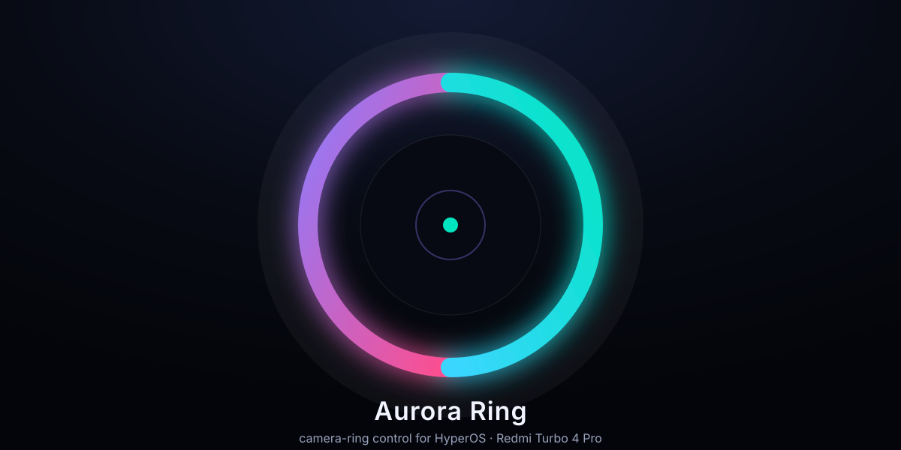

# Aurora Ring

Modern RGB camera-ring control for Xiaomi HyperOS — built from scratch for the
**Redmi Turbo 4 Pro (onyx)**, with a layered render engine, a beat-locked audio
analyser and a UI that does not fight the hardware.

> Aurora Ring is an independent rebuild. The hardware protocol was learned from
> the excellent reverse-engineering work in **DashDazz** (olivia-hye) and
> **HaloLight** (fan-world-me); the app, engine and UI here are new.



## What it does

- **12 animations** — Rainbow, Aurora, Breathe, Solid, Dual ring, Spin, Flow,
  Ember, Ice, Strobe, Candle, Audio visualiser.
- **Dual ring** — true two-half hardware split, duo spin, alternating, crossfade,
  fire & ice and rainbow duo.
- **Hardware spin** — uses the AW21024 spot masks for a real orbiting light.
- **8 palettes** — Spectrum, Cyberpunk, Sunset, Ocean, Pastel, Ember, Aurora, Neon.
- **Beat-locked audio reactive** — spectral-flux onsets, tempo histogram,
  phase-locked loop and latency compensation.
- **Notification alerts** — flash / pulse / wave / solid, per-app colours and
  per-app durations, composited over the running animation.
- **Extras over DashDazz** — charging breathe, low-battery warning, screen-state
  rules, notification-only mode that actually keeps working, app filters for
  both audio and alerts, frame-rate profiles, LED repair/reset, boot restore,
  Quick Settings tile, per-app alert durations.
- **Root first, Shizuku fallback** — direct AW21024 register writes when root is
  available; `miui.lights.ILightsManager` through Shizuku otherwise.

## Requirements

- Redmi Turbo 4 Pro / POCO F7 (`onyx`), HyperOS, Android 14+.
- Root (Magisk / KernelSU) for the full feature set.
- Shizuku for the no-root fallback (solid colours only).
- Notification access for alert flashes.

## Install

Grab the APK from [Releases](../../releases). The release build is signed with a
project keystore; debug builds use the Android debug key.

## How it is built

```
app/src/main/java/dev/aurora/ring/
├── MainActivity.kt          Compose host, permission launchers
├── led/
│   ├── LightsApi.kt         hand-written ILightsManager client + persistent su shell
│   └── LedController.kt     single hardware writer, backend selection, de-duplication
├── audio/
│   ├── Fft.kt               radix-2 FFT, pre-allocated buffers
│   └── BeatEngine.kt        capture, spectral flux, tempo/PLL, pulse scheduling
├── engine/
│   ├── Animator.kt          pure frame generator (shared with the preview)
│   └── RenderEngine.kt      layer arbiter: base + transient overlays
├── service/
│   ├── RingService.kt       foreground service, receivers, actions
│   ├── NotifListener.kt     notification trigger + media-session tracking
│   ├── MediaGate.kt         "only these apps" gate for audio
│   ├── RingTileService.kt   Quick Settings tile
│   └── BootReceiver.kt      restore after reboot
├── data/                    settings, palettes, modes
└── ui/                      theme, components, preview, tabs, setup, app picker
```

### Render pipeline

```
                 ┌─────────────────────────────┐
  every frame →  │ Animator.frame(now, config) │ → base layer
                 └─────────────────────────────┘        │
                                                        ▼
  notification → ┌───────────────────┐          ┌───────────────┐
  charging     → │ transient layers  │ ───────► │  compositor   │ → LedController
  low battery  → └───────────────────┘          └───────────────┘
```

`RenderEngine` owns a single thread. It asks `Animator` for the base frame,
blends any active transient layer over it with a fade-in/fade-out envelope, and
hands the result to `LedController`, which de-duplicates identical frames and
rate-limits the Shizuku path. Mode changes crossfade over 380 ms.

## The notification-only bug, and the fix

DashDazz treated "Notification only" as a screen mode that stopped the animation
loop. Its `onStartCommand` branch called `pauseAnimationForScreenOff()` and
returned early, and `shouldRunNow()` returned false for that mode — so
`launchAnimationLoop()` and `startAudioEngineIfNeeded()` were never called. The
audio engine therefore never started, and every feature that depended on the
loop died with it.

Aurora Ring separates **what is visible** from **what is running**:

- the service and audio engine always run while the ring is enabled;
- the base layer is simply *not rendered* in notification-only mode;
- alert layers are independent and still composite over black;
- if audio reactive is enabled, the base layer is the audio visualiser, so it
  keeps rendering (and reacting) even in notification-only mode.

Stopping notifications never restarts the animation, and starting an animation
never tears down the audio engine.

## Why the old beat sync felt late

The original detector ran a slow envelope follower (≈200 ms release) over a
normalised band level and fired when the level crossed `baseline × threshold`.
That measures *loudness*, not *attack*: by the time the envelope crosses the
line the transient is already over, and peak normalisation smears it further.
Two independent tempo trackers and a 150–430 ms clamping window added jitter,
and nothing compensated for analysis/write latency.

Aurora Ring replaces the whole path:

1. **Spectral flux** — sum of positive magnitude changes between consecutive
   FFT frames, divided by total energy. Level independent, attack sensitive.
2. **Adaptive threshold** — `median + 2.6 × MAD + floor` over a ~2 s ring
   buffer, divided by the sensitivity setting.
3. **Tempo histogram** — inter-onset intervals folded into 60–180 BPM, decayed
   per onset; the strongest bucket sets the period.
4. **Phase-locked loop** — onsets nudge the predicted beat grid by 35 % of the
   phase error; the grid free-runs between onsets.
5. **Latency compensation** — pulses are emitted `latencyMs` *before* the
   predicted beat, so the LED peak lands on the audible kick instead of after
   it. The default is 45 ms; the slider goes to 200 ms.

The engine emits a fast-attack / 125 ms-decay envelope, which reads as a crisp
pulse rather than a fade.

## Hardware notes

Full details in [docs/HARDWARE.md](docs/HARDWARE.md). Short version:

- LED driver: **Awinic AW21024**, 24 channels, I²C address `0x30` on bus 6,
  exposed as `/sys/class/leds/aw21024_led/` (`reg`, `hwen`, `effect`, ...).
- Binder service: `miui.lights.ILightsManager`, four transactions:
  1. `setColorfulLight(pkg, styleType, userId)`
  2. `setColorCommon(color, pkg, styleType, userId)`
  3. `setColorLed(...)` — empty on HyperOS
  4. `setCustomLight(color, flashMode, onMs, offMs, brightnessMode, pkg, styleType, userId)`
- `setColorCommon(color, "com.android.camera", 3, 0)` is the flicker-free
  animation call. `setCustomLight` schedules a Handler auto-off per call and
  flickers at animation rates.
- Root path writes registers directly through a persistent `su` shell:
  `0xa8/0xa9/0xaa` RGB, `0xab` channel mask (`0xff` all, `0x40`/`0x08` spots),
  `0x5c–0x5e` + `0x53–0x55` dual halves, `0x7a`/`0xac` mode bits.
- Never write `echo -1` to the register node; use `0xFFFEFEFE`.

## Build

GitHub Actions builds every push to `main` and publishes a release on `v*` tags.
The workflow needs four repository secrets for release signing:

| Secret | Value |
| --- | --- |
| `KEYSTORE_BASE64` | base64 of a PKCS#12 keystore |
| `KEYSTORE_PASSWORD` | keystore password |
| `KEY_ALIAS` | key alias |
| `KEY_PASSWORD` | key password |

Without them the APK is debug-signed, which is fine for local testing.

Local build: `./gradlew assembleDebug` (JDK 17, Android SDK 35).

## Credits

- **DashDazz** by olivia-hye — feature baseline and the original register map.
- **HaloLight** by fan-world-me — binder/architecture documentation.
- Awinic AW21024 driver sources shipped with the device kernel tree.

Not affiliated with Xiaomi. Use at your own risk; writing LED registers is
reversible (`Reset to stock` in the app restores the system scene).
